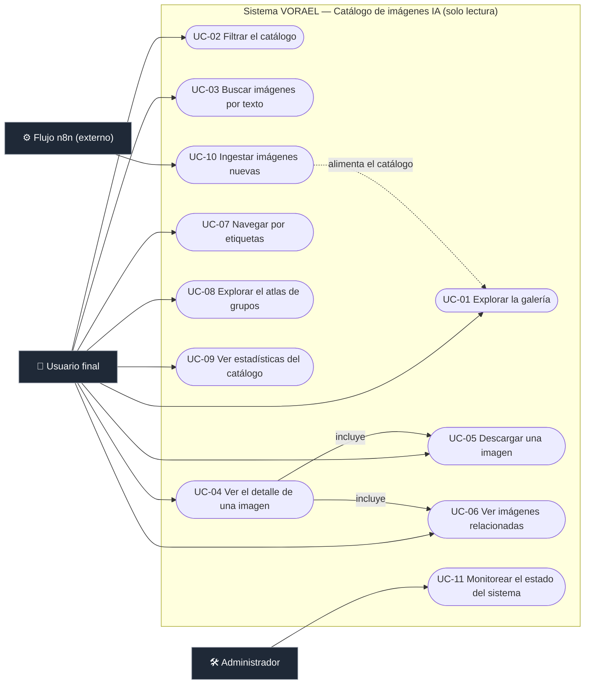
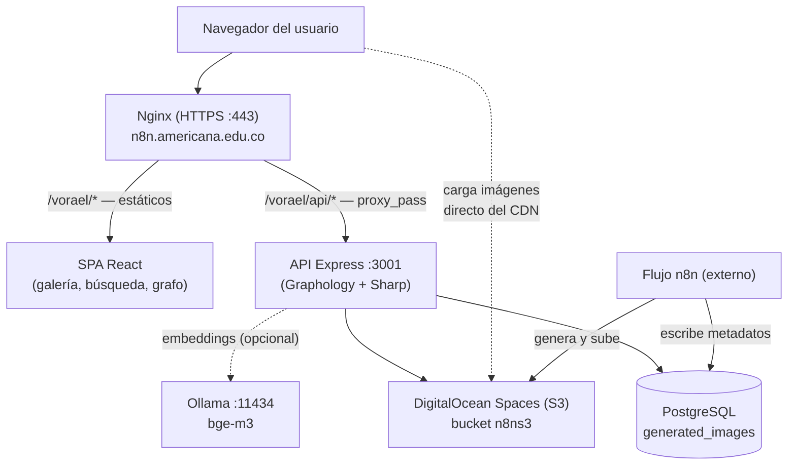
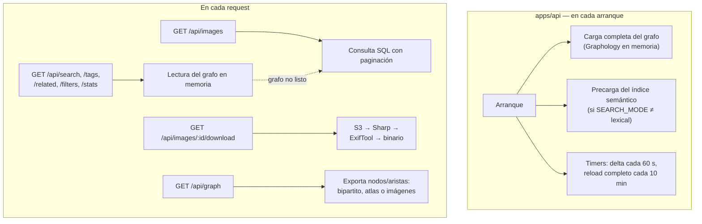

# VORAEL — Documento de Alcance del MVP

> **Proyecto:** VORAEL — Banco de imágenes generadas por IA
> **Institución:** Corporación Universitaria Americana
> **Versión del documento:** 1.1 — 2026-11-24
> **Estado del sistema documentado:** MVP en producción — https://n8n.americana.edu.co/vorael/

Este documento define el **Producto Mínimo Viable (MVP)** de VORAEL: qué es, qué
incluye, cómo funciona, qué requisitos cumple y qué queda fuera de alcance. Está
pensado para lectura mixta: la dirección puede leer las secciones 1 a 6 sin
conocimientos técnicos; el equipo técnico encontrará en las secciones 7 a 13 la
referencia precisa de arquitectura, requisitos y modelo de datos.

Para detalle de implementación, ver [ARQUITECTURA.md](ARQUITECTURA.md). Para
despliegue, ver [DEPLOY.md](DEPLOY.md).

---

## 1. Resumen ejecutivo

VORAEL es un **catálogo web de imágenes generadas por inteligencia artificial**
para la Corporación Universitaria Americana. Funciona como un "Pinterest interno":
un proceso automático externo (n8n) genera las imágenes y las publica en la nube;
VORAEL las presenta en una galería donde se pueden **buscar, filtrar, explorar
por relaciones y descargar** con metadatos incrustados.

**En una frase:** VORAEL convierte un archivo plano de miles de imágenes IA en
un catálogo consultable y explorable visualmente, sin generar ni modificar
imágenes — es un sistema de **solo lectura**.

**Valor para la institución:**

- Centraliza y hace accesible el banco de imágenes IA generado por los flujos
  de n8n, con una interfaz pública bajo HTTPS.
- Permite encontrar imágenes por descripción libre (búsqueda semántica), no solo
  por palabras exactas.
- Descarga imágenes optimizadas con metadatos de procedencia incrustados
  (autoría institucional, prompt, estilo, tags), listas para su uso en
  materiales académicos y de comunicación.
- Ofrece una visión de conjunto del catálogo: grupos temáticos, tendencias de
  estilo/mood y estadísticas.

---

## 2. Objetivos

### 2.1 Objetivo general

**Publicar un catálogo web de solo lectura que permita descubrir, buscar y
descargar imágenes generadas por IA**, sincronizado automáticamente con el banco
de imágenes que llena el flujo de n8n, con metadatos de procedencia incrustados
en cada descarga.

### 2.2 Objetivos específicos (MVP)

| # | Objetivo | Estado |
|---|---|---|
| OE-1 | Exponer la galería completa con paginación e scroll infinito | ✅ En producción |
| OE-2 | Permitir búsqueda por texto con relevancia (léxica + semántica + híbrida) | ✅ En producción |
| OE-3 | Permitir filtrar por estilo, mood y caso de uso | ✅ En producción |
| OE-4 | Mostrar las relaciones entre imágenes como grafo interactivo y atlas de grupos | ✅ En producción |
| OE-5 | Descargar imágenes en WebP/PNG/JPG con metadatos EXIF/IPTC/XMP incrustados | ✅ En producción |
| OE-6 | Reflejar imágenes nuevas del banco sin reiniciar el sistema (sincronización automática) | ✅ En producción |
| OE-7 | Funcionar sin servicios externos en desarrollo (modo mock) y degradar sin caídas ante fallos parciales | ✅ En producción |

---

## 3. Alcance del MVP

### 3.1 Dentro del alcance (funciona hoy en producción)

| Capa | Funcionalidad |
|---|---|
| **Galería** | Grid responsivo con scroll infinito (24 imágenes por página, ordenadas por fecha descendente) |
| **Filtros** | Por estilo artístico, mood (estado emocional) y caso de uso sugerido |
| **Búsqueda** | Por texto libre con tres modos: **léxica** (coincidencia por tokens con puntuación de relevancia), **semántica** (similitud por embeddings con Ollama + bge-m3) e **híbrida** (`percent = max(metadatos, coseno × 100)`). Degradación automática a léxica si el servicio de embeddings no está disponible |
| **Detalle de imagen** | Imagen ampliada, prompt original y mejorado, sujeto, estilo, mood, paleta de colores, tags y formato de descarga |
| **Descarga** | WebP lossless, PNG sin compresión o JPG calidad 100, convertidos al vuelo con Sharp; con metadatos EXIF/IPTC/XMP incrustados (namespace propio `XMP-vorael:`) |
| **Relacionadas** | "Imágenes similares" calculadas por similitud de metadatos en el grafo (Jaccard + co-ocurrencia de tags) |
| **Grafo interactivo** | Vista de **atlas de grupos** (comunidades detectadas con Louvain) y vista de **imágenes** conectadas por metadatos compartidos, navegable con click |
| **Subgrafo de búsqueda** | Vista de grafo del top-100 de resultados de una búsqueda (toggle "Ver grafo") |
| **Etiquetas (tags)** | Nube de tags ordenada por frecuencia y página por tag con sus imágenes |
| **Estadísticas** | Total de imágenes, top-10 estilos, top-10 moods y top-20 tags |
| **API REST pública** | 11 endpoints GET de solo lectura bajo `/vorael/api/` |
| **Sincronización** | Volcado del catálogo al arrancar y cada 60 s + deltas del grafo cada 60 s + reload completo cada 10 min para reconciliar bajas/ediciones |
| **Metadatos** | Incrustación en descargas (opcional vía `METADATA_EMBED=exiftool`), con degradación silenciosa si exiftool no está instalado |
| **Modos de operación** | Mock total (`DB_MOCK=true`, sin DB ni S3), archivo local (`DB_FILE`) con auto-sync, y producción (PostgreSQL + Spaces) |
| **QA** | 204 pruebas automatizadas (Vitest + Supertest) que corren sin servicios externos |

### 3.2 Fuera de alcance (post-MVP)

Estos puntos **no forman parte del MVP**: no existen hoy o están explícitamente
diferidos. Ver el roadmap completo en la sección 11.

- Autenticación, usuarios y roles (todo el catálogo es público y de solo lectura).
- Subida, edición o eliminación de imágenes desde la interfaz (la ingesta la hace
  exclusivamente el flujo externo de n8n).
- Búsqueda inversa por imagen, favoritos, colecciones o comentarios.
- API con autenticación, claves de acceso o rate limiting.
- Multi-idioma, notificaciones o integración con otras plataformas.

### 3.3 Fuera de alcance del sistema VORAEL (responsabilidad externa)

| Componente | Responsable | Nota |
|---|---|---|
| Generación de imágenes con IA | Flujo de n8n (externo al repo) | VORAEL no genera imágenes |
| Subida de archivos a S3 | Flujo de n8n | VORAEL solo lee (los scripts de backfill son herramientas de mantenimiento, no parte del flujo normal) |
| Poblado de la base de datos | Flujo de n8n | VORAEL solo lee la tabla `generated_images` |

---

## 4. Actores

| Actor | Tipo | Descripción |
|---|---|---|
| **Usuario final** | Principal | Cualquier persona con acceso al catálogo público (estudiantes, docentes, personal, público externo). No requiere autenticación |
| **Flujo n8n** | Sistema externo | Proceso automatizado fuera de este repositorio que genera imágenes con IA, las sube a DigitalOcean Spaces y escribe sus metadatos en PostgreSQL. Es quien "llena" el catálogo |
| **Administrador** | Principal | Persona del equipo técnico que despliega, monitorea y mantiene el sistema; usa el endpoint de salud y los scripts de mantenimiento |
| **Sistemas de soporte** | Secundario | PostgreSQL (datos), DigitalOcean Spaces/S3 (archivos), ExifTool (metadatos), Ollama (embeddings), Nginx (proxy HTTPS) |

---

## 5. Diagrama de casos de uso

### Tabla resumen

| UC | Caso de uso | Actor principal | Prioridad |
|---|---|---|---|
| UC-01 | Explorar la galería | Usuario final | Must |
| UC-02 | Filtrar el catálogo | Usuario final | Must |
| UC-03 | Buscar imágenes por texto | Usuario final | Must |
| UC-04 | Ver el detalle de una imagen | Usuario final | Must |
| UC-05 | Descargar una imagen | Usuario final | Must |
| UC-06 | Ver imágenes relacionadas | Usuario final | Should |
| UC-07 | Navegar por etiquetas | Usuario final | Should |
| UC-08 | Explorar el atlas de grupos | Usuario final | Should |
| UC-09 | Ver estadísticas del catálogo | Usuario final / Dirección | Could |
| UC-10 | Ingestar imágenes nuevas | Flujo n8n (externo) | Must |
| UC-11 | Monitorear el estado del sistema | Administrador | Should |

---

## 6. Casos de uso detallados

### UC-01 — Explorar la galería

| Campo | Contenido |
|---|---|
| **Actor** | Usuario final |
| **Precondición** | El catálogo está desplegado y accesible por HTTPS |
| **Flujo básico** | 1. El usuario abre la galería. 2. El sistema muestra las imágenes más recientes en un grid (24 por página). 3. El usuario baja al final de la página. 4. El sistema carga automáticamente la siguiente página (scroll infinito) sin recargar. 5. Repite 3–4 tantas veces como quiera |
| **Flujos alternativos** | 3a. Si el sistema de datos no está listo aún, se muestran esqueletos de carga (skeletons). 4a. Si una página falla, se muestra un estado de error con botón "reintentar" |
| **Postcondición** | El usuario ha visto tantas imágenes como haya bajado; no se pierde la posición |

### UC-02 — Filtrar el catálogo

| Campo | Contenido |
|---|---|
| **Actor** | Usuario final |
| **Precondición** | Hay imágenes en el catálogo (UC-01) |
| **Flujo básico** | 1. El usuario abre el panel de filtros. 2. El sistema lista los valores disponibles de estilo, mood y caso de uso, con el conteo de imágenes de cada uno. 3. El usuario selecciona uno o más valores. 4. El sistema muestra solo las imágenes que cumplen los filtros seleccionados, con scroll infinito |
| **Flujos alternativos** | 4a. Si la combinación no tiene resultados, se muestra un estado vacío con sugerencia de quitar filtros. 3a. Cambiar o quitar un filtro actualiza los resultados en el acto |
| **Postcondición** | El grid muestra únicamente imágenes que cumplen los filtros activos |

### UC-03 — Buscar imágenes por texto

| Campo | Contenido |
|---|---|
| **Actor** | Usuario final |
| **Precondición** | El motor de búsqueda está activo (grafo en memoria cargado, o fallback SQL) |
| **Flujo básico** | 1. El usuario escribe una o varias palabras (o una frase completa) en el buscador. 2. El sistema espera 300 ms tras la última tecla (debounce) y ejecuta la búsqueda. 3. Se muestran los resultados ordenados por relevancia, con scroll infinito |
| **Modos** | El usuario puede elegir entre **Léxica** (coincidencia por palabras exactas, con singular/plural), **Semántica** (similitud de significado por embeddings — encuentra "felino" cuando se busca "gato") e **Híbrida** (una ambas señales y se queda con el % más alto, modo por defecto cuando el servidor lo tiene activo) |
| **Flujos alternativos** | 3a. Si el servicio de embeddings no está disponible, el sistema degrada silenciosamente a modo léxico. 2a. Consultas vacías devuelven lista vacía, no error. 3b. El usuario puede activar "Ver grafo" para ver el subgrafo del top-100 de resultados |
| **Postcondición** | El usuario ve los resultados más relevantes arriba, o una lista vacía con el aviso correspondiente |

### UC-04 — Ver el detalle de una imagen

| Campo | Contenido |
|---|---|
| **Actor** | Usuario final |
| **Precondición** | La imagen existe en el catálogo |
| **Flujo básico** | 1. El usuario hace click en una imagen (desde la galería, resultados, tag o grafo). 2. El sistema muestra la imagen ampliada, el prompt original, el prompt mejorado, el sujeto, estilo, mood, paleta de colores, tags y la fecha de creación. 3. Desde ahí puede descargarla (UC-05), ver relacionadas (UC-06) o navegar a un tag (UC-07) |
| **Flujos alternativos** | 2a. Si el id no existe, se muestra una página 404 del cliente |
| **Postcondición** | El usuario conoce la imagen y dispone de sus metadatos completos |

### UC-05 — Descargar una imagen

| Campo | Contenido |
|---|---|
| **Actor** | Usuario final |
| **Precondición** | El usuario está en el detalle de la imagen (UC-04) y la imagen tiene archivo en S3 |
| **Flujo básico** | 1. El usuario elige el formato: WebP (lossless), PNG (sin compresión) o JPG (calidad 100). 2. El sistema descarga el original de S3, lo convierte con Sharp en memoria y lo entrega como archivo adjunto (`Content-Disposition: attachment`) |
| **Incrustación de metadatos** | Si `METADATA_EMBED=exiftool`, el archivo descargado lleva incrustados: descripción (prompt), autoría institucional ("Corporación Universitaria Americana - VORAEL"), keywords (tags), título, y el namespace propio `XMP-vorael:` con id, estilo, mood, caso de uso, paleta y fecha. Cualquier herramienta de metadatos (Adobe Bridge, Lightroom, ExifTool) los lee |
| **Flujos alternativos** | 2a. Si exiftool no está instalado o falla, la imagen se entrega sin metadatos (degradación silenciosa, sin error al usuario). 2b. Si el formato pedido no es válido, se usa WebP por defecto. 2c. Si la imagen no tiene archivo en S3, error 500 |
| **Postcondición** | El usuario tiene el archivo local en el formato elegido, con nombre derivado del original |

### UC-06 — Ver imágenes relacionadas

| Campo | Contenido |
|---|---|
| **Actor** | Usuario final |
| **Precondición** | El usuario está en el detalle de una imagen (UC-04) |
| **Flujo básico** | 1. El sistema calcula y muestra hasta 8 imágenes relacionadas. 2. El usuario puede abrir cualquiera y seguir explorando en cadena |
| **Criterio de relación** | Similitud de metadatos en el grafo: intersección de vecinos compartidos (tags, estilo, mood, caso de uso, colores) + bonus por co-ocurrencia fuerte de tags |
| **Flujos alternativos** | 2a. Si el id no existe o no hay relaciones, se muestra lista vacía |
| **Postcondición** | El usuario ha descubierto imágenes afines sin conocer sus palabras clave |

### UC-07 — Navegar por etiquetas (tags)

| Campo | Contenido |
|---|---|
| **Actor** | Usuario final |
| **Precondición** | Hay imágenes con tags en el catálogo |
| **Flujo básico** | 1. El usuario abre la página de tags. 2. El sistema lista los tags ordenados por frecuencia (hasta 500). 3. El usuario elige un tag. 4. El sistema muestra las imágenes con ese tag en paginación |
| **Flujos alternativos** | 4a. Tag inexistente → lista vacía |
| **Postcondición** | El usuario ve el conjunto de imágenes asociadas a un concepto concreto |

### UC-08 — Explorar el atlas de grupos

| Campo | Contenido |
|---|---|
| **Actor** | Usuario final |
| **Precondición** | El grafo está cargado y tiene imágenes |
| **Flujo básico** | 1. El usuario abre la página del grafo. 2. El sistema muestra el **atlas**: cada burbuja es un grupo (comunidad) de imágenes parecidas, detectada automáticamente con el algoritmo Louvain sobre los metadatos compartidos. El tamaño refleja la cantidad de imágenes y el color identifica el grupo. 3. El usuario hace click en una burbuja (o en la leyenda). 4. El sistema muestra las imágenes de ese grupo unidas por los metadatos que comparten, dibujadas con vis-network. 5. El usuario hace click en un nodo de imagen para abrir su detalle (UC-04) o en un nodo de comunidad desde el panel de información |
| **Flujos alternativos** | 2a. Si la detección de comunidades está desactivada (`GRAPH_COMMUNITIES=false`), se muestra directamente la vista de imágenes. 4a. Botón "Volver al atlas" para regresar |
| **Postcondición** | El usuario percibe la temática del catálogo sin necesidad de conocer sus etiquetas |

### UC-09 — Ver estadísticas del catálogo

| Campo | Contenido |
|---|---|
| **Actor** | Usuario final / Dirección |
| **Precondición** | Hay imágenes en el catálogo |
| **Flujo básico** | 1. El usuario abre la página de estadísticas. 2. El sistema muestra el total de imágenes, los 10 estilos más usados, los 10 moods más frecuentes y los 20 tags principales |
| **Postcondición** | El usuario/dirección tiene una radiografía cuantitativa del banco de imágenes |

### UC-10 — Ingestar imágenes nuevas (actor externo)

| Campo | Contenido |
|---|---|
| **Actor** | Flujo de n8n (sistema externo) |
| **Precondición** | n8n tiene acceso de escritura a S3 y a PostgreSQL |
| **Flujo básico** | 1. n8n genera una imagen con IA. 2. Sube el archivo a DigitalOcean Spaces. 3. Escribe la fila en `generated_images` (id, s3_key, s3_url, prompts, tags, estilo, subject, mood, paleta, caso de uso, nombre de archivo, fecha). 4. VORAEL detecta el cambio en su siguiente ciclo de sincronización (≤ 60 s) y la incorpora al grafo y al catálogo **sin reiniciar** |
| **Flujos alternativos** | 4a. Cada 10 minutos se hace un reload completo para reconciliar bajas y ediciones (las deltas no las detectan). 4b. Si PostgreSQL está caído, el grafo conserva el último snapshot válido y reintenta en cada ciclo |
| **Postcondición** | La imagen nueva es navegable, buscable, filtrable y descargable en menos de un minuto |

### UC-11 — Monitorear el estado del sistema

| Campo | Contenido |
|---|---|
| **Actor** | Administrador |
| **Precondición** | El API está desplegado |
| **Flujo básico** | 1. El administrador consulta `GET /vorael/api/health`. 2. El sistema responde con estado general, filas, nodos y aristas del grafo, fecha de construcción, tiempo de build y modo de búsqueda activo (léxico/semántico/híbrido y modelo) |
| **Flujos alternativos** | 1a. El endpoint responde aunque PostgreSQL esté mal (config tolerante): permite diagnosticar sin caer |
| **Postcondición** | El administrador sabe si el sistema está operativo y con qué datos |

---

## 7. Arquitectura del sistema (resumen)

> Detalle completo en [ARQUITECTURA.md](ARQUITECTURA.md).

### 7.1 Componentes

Monorepo **pnpm** con dos aplicaciones:

| | Stack | Rol |
|---|---|---|
| `apps/web` | React 18 · Vite 5 · TypeScript · Tailwind · TanStack Query · vis-network | SPA servida como estáticos bajo `/vorael/` |
| `apps/api` | Express 4 · TypeScript (CommonJS) · `pg` · AWS SDK v3 · Sharp · Graphology | API REST en `127.0.0.1:3001`, expuesta en `/vorael/api/` |

Se apoya en: **PostgreSQL** (tabla `generated_images`, solo lectura),
**DigitalOcean Spaces** (S3, bucket `n8ns3`), **ExifTool** (incrustación de
metadatos, opcional), **Ollama** con modelo `bge-m3` (embeddings, opcional) y
**Nginx** (proxy HTTPS y estáticos).

### 7.2 Flujo de datos

### 7.3 Motor de búsqueda

| Modo | Cómo funciona | Requisito |
|---|---|---|
| **Léxica** (default) | Tokenización (minúsculas, singular/plural, sin acentos), stopword filtering, puntuación por cobertura de términos significativos | Ninguno |
| **Semántica** | Embeddings de imágenes precalculados en `image_embeddings` + embedding de la query vía Ollama; top-k por similitud coseno con filtro anti-ruido (`SEMANTIC_MIN_SCORE=0.65`) | Ollama + `image_embeddings` poblada |
| **Híbrida** | Une top-100 léxico + top-100 semántico; `percent = max(metadatos, coseno × 100)` | Ídem |

En cualquiera de los modos, si los insumos semánticos fallan, el sistema degrada
a léxico sin error. El modo activo se expone en `/api/health` y el usuario puede
sobreescribirlo por URL (`?mode=lexical|semantic|hybrid`).

### 7.4 Motor de grafos

- **Nodos:** imagen, tag, estilo, mood, caso de uso y color — pintados por tipo.
- **Aristas:** `TAGGED_WITH`, `HAS_STYLE`, `HAS_MOOD`, `HAS_USECASE`,
  `HAS_COLOR` (imagen → metadato) y `CO_OCCURS_WITH` entre tags (peso = nº de
  imágenes que los comparten).
- **Comunidades:** Louvain sobre el grafo imagen+metadatos → agrupa imágenes
  parecidas en "cardúmenes" con color propio; alimenta el atlas del UC-08.
- **Sincronización:** deltas por watermark `(created_at, id)` con precisión de
  microsegundos cada 60 s + reload completo cada 10 min. Swap atómico: nunca se
  ve un grafo a medias.

---

## 8. Requisitos

Prioridad según **MoSCoW**: **M**ust (imprescindible), **S**hould (importante),
**C**ould (deseable), **W**on't (fuera de alcance esta versión — ver §3.2).

### 8.1 Requisitos funcionales

| ID | Requisito | Prioridad | Estado |
|---|---|---|---|
| RF-01 | Mostrar el catálogo en un grid paginado con scroll infinito, ordenado por fecha descendente | M | ✅ |
| RF-02 | Filtrar el catálogo por estilo, mood y caso de uso, mostrando el conteo de cada valor | M | ✅ |
| RF-03 | Buscar por texto con puntuación de relevancia (tags > subject > prompts) y coincidencia por palabra completa (no subcadena) | M | ✅ |
| RF-04 | Ofrecer los tres modos de búsqueda (léxica, semántica, híbrida) con degradación automática a léxica | S | ✅ |
| RF-05 | Mostrar el detalle completo de una imagen (prompts, sujeto, estilo, mood, paleta, tags, fecha) | M | ✅ |
| RF-06 | Descargar imágenes convertidas a WebP lossless / PNG sin compresión / JPG calidad 100 | M | ✅ |
| RF-07 | Incrustar metadatos EXIF/IPTC/XMP (incluido el namespace propio `XMP-vorael:`) en las descargas cuando `METADATA_EMBED=exiftool` | M | ✅ |
| RF-08 | Recomendar imágenes relacionadas por similitud de metadatos (Jaccard + co-ocurrencia) | S | ✅ |
| RF-09 | Listar tags por frecuencia y servir la página de imágenes de cada tag | S | ✅ |
| RF-10 | Explorar el atlas de comunidades (Louvain) y drill-down a las imágenes de un grupo | S | ✅ |
| RF-11 | Exponer las estadísticas del catálogo (total, top estilos, moods, tags) | C | ✅ |
| RF-12 | Exponer una API REST de solo lectura con 11 endpoints GET | M | ✅ |
| RF-13 | Volcar el catálogo al arrancar y cada 60 s; sincronizar el grafo con deltas (60 s) y reload completo (10 min), sin reiniciar el proceso | M | ✅ |
| RF-14 | Visualizar el subgrafo del top-100 de resultados de una búsqueda | C | ✅ |
| RF-15 | Operar en modo mock (`DB_MOCK=true`) o con archivo local (`DB_FILE`) sin PostgreSQL ni S3, para desarrollo y tests | S | ✅ |
| RF-16 | Generar datos sintéticos deterministas de prueba (`seed:generate`) | C | ✅ |
| RF-17 | Responder un health check con estado del grafo y modo de búsqueda | S | ✅ |
| RF-18 | Proveer scripts de mantenimiento: exportación portable, backfill en S3 (con guardia de escritura) y reconstrucción desde archivos (recovery) | C | ✅ |

### 8.2 Requisitos no funcionales

| ID | Requisito | Prioridad |
|---|---|---|
| RNF-01 | **Solo lectura:** el sistema operativo nunca escribe en PostgreSQL ni en S3; los scripts de escritura son herramientas manuales con guardias explícitas (`ALLOW_BACKFILL_WRITE=true`) | M |
| RNF-02 | **Disponibilidad:** servicio 24/7 detrás de Nginx; ante fallos de base de datos el grafo conserva el último snapshot válido y reintenta | M |
| RNF-03 | **Rendimiento:** respuestas desde el grafo en memoria en milisegundos; imágenes del grid cargadas directamente desde el CDN de Spaces; límites de página ≤ 100 y de grafo ≤ 600 nodos | M |
| RNF-04 | **Degradación graceful:** sin Ollama → búsqueda léxica; sin exiftool → descarga sin metadatos; sin grafo → SQL; parámetros inválidos → se corrigen (nunca errores 400) | M |
| RNF-05 | **Seguridad:** ningún secreto en el repositorio (`.env` gitignored); API escuchando solo en `127.0.0.1` detrás de Nginx (HTTPS); sin endpoints de escritura; CORS configurable | M |
| RNF-06 | **Escalabilidad:** operativo con el catálogo actual (~53 800 imágenes); carga total del grafo solo en arranque y reloads, deltas en ciclo normal | S |
| RNF-07 | **Portabilidad:** monorepo pnpm; release empaquetado como tar.gz; los binarios nativos (sharp) se compilan por plataforma | S |
| RNF-08 | **Observabilidad:** logs de arranque, sincronización y errores; health check público con métricas del grafo | S |
| RNF-09 | **Testing:** 204 pruebas automatizadas que corren sin servicios externos (modo mock), cubriendo búsqueda, grafo, endpoints, sincronización, embeddings y metadatos | M |
| RNF-10 | **Usabilidad:** interfaz responsiva, tema oscuro con contraste, carga progresiva (skeletons), debounce en el buscador, estados vacíos y de error accionables | S |

---

## 9. Criterios de aceptación del MVP

El MVP se considera entregado si:

- [ ] `pnpm build` compila API y web sin errores; `pnpm test` pasa con las 204 pruebas en verde.
- [ ] La galería carga en `https://n8n.americana.edu.co/vorael/` con scroll infinito y filtros operativos.
- [ ] Una búsqueda con cualquier modo devuelve resultados ordenados por relevancia; con el servicio de embeddings caído sigue funcionando la búsqueda léxica (sin error visible).
- [ ] El detalle de una imagen muestra prompts, paleta y tags; la descarga entrega el archivo con `Content-Disposition` y, con `METADATA_EMBED=exiftool`, metadatos legibles por ExifTool (verificable con `exiftool -a -G1 imagen.webp`).
- [ ] La página del grafo muestra el atlas de comunidades y permite entrar a un grupo y navegar a sus imágenes.
- [ ] Una imagen insertada en la base de datos por n8n aparece en el catálogo en ≤ 60 segundos, sin reiniciar el API.
- [ ] Todos los endpoints de `/vorael/api/` responden JSON correcto (verificable con `curl` o el health check).
- [ ] Con `DB_MOCK=true` el sistema completo funciona sin PostgreSQL ni S3 (arranque limpio en una máquina nueva).
- [ ] Ningún `.env` real está versionado; el API no escucha en interfaces públicas.

---

## 10. Modelo de datos (resumen)

### `generated_images` — tabla principal (solo lectura para VORAEL)

| Columna | Tipo | Contenido |
|---|---|---|
| `id` | text (PK) | Identificador único (lo asigna n8n) |
| `s3_key` | text | Clave del archivo en Spaces |
| `s3_url` | text | URL pública del archivo |
| `original_prompt` | text | Prompt original usado para generar la imagen |
| `enhanced_prompt` | text | Prompt mejorado (si existe) |
| `tags` | text[] | Etiquetas libres |
| `style` | text | Estilo artístico (ej. `Photorealistic`) |
| `subject` | text | Sujeto principal |
| `mood` | text | Estado emocional (ej. `Calm`) |
| `color_palette` | text[] | Paleta de colores en hex |
| `use_case` | text | Caso de uso sugerido (ej. `Wallpaper`) |
| `filename` | text | Nombre original del archivo |
| `created_at` | timestamptz | Fecha de creación (clave del orden y del watermark de sync) |

### `image_embeddings` — vectores semánticos (opcionales)

| Columna | Tipo | Contenido |
|---|---|---|
| `id` | text (PK, FK) | Mismo id que la imagen |
| `embedding` | real[] | Vector de 1024 dimensiones (modelo `bge-m3`) |
| `model` | text | Modelo que lo generó (permite re-embeddings selectivos) |
| `updated_at` | timestamptz | Última actualización |

Tabla aparte a propósito: los resyncs de `generated_images` no destruyen los
vectores. Se cargan en memoria al arrancar (Map id → Float32Array).

### Tipos de nodo del grafo

| Tipo | Ejemplo de id | Color |
|---|---|---|
| imagen | `img-001` | Indigo `#6366f1` |
| tag | `tag:gato` | Ámbar `#f59e0b` |
| estilo | `style:Photorealistic` | Verde `#22c55e` |
| mood | `mood:Calm` | Púrpura `#a855f7` |
| caso de uso | `ucase:Wallpaper` | Cian `#06b6d4` |
| color | `color:#FFD700` | Gris `#6b7280` |
| comunidad | `community:3` | Paleta cíclica propia |

---

## 11. Roadmap post-MVP

Propuestas priorizadas para las siguientes iteraciones (todas **fuera** del
alcance actual):

| # | Iniciativa | Valor | Esfuerzo estimado |
|---|---|---|---|
| 1 | **Autenticación y roles** (admin/editor) con carga manual de imágenes desde la interfaz | Reduce la dependencia total de n8n | Alto |
| 2 | **Búsqueda inversa por imagen** (embedding visual de la imagen completa) | "Encontrar imágenes parecidas a esta" | Medio |
| 3 | **Favoritos y colecciones compartibles** | Uso institucional recurrente | Medio |
| 4 | **Feedback de relevancia** (clicks → re-ranking aprendido) | Mejora continua de la búsqueda | Medio |
| 5 | **API con claves y rate limiting** + webhooks de novedades | Integración con otros sistemas | Medio |
| 6 | **Miniaturas y watermarks** en descarga; formatos/tamaños adicionales | Protección de marca y performance | Bajo-Medio |
| 7 | **Panel administrativo** con métricas de uso (más consultadas, búsquedas sin resultados) | Toma de decisiones sobre el banco | Medio |
| 8 | **Interfaz multi-idioma** (ES/EN) | Alcance internacional | Bajo |
| 9 | **Anotaciones/comentarios** en imágenes por usuarios autenticados | Colaboración | Alto |
| 10 | **Escalado del motor** (índice sharded o externo) si el catálogo supera ~200k imágenes | Sostenibilidad | Alto |

---

## 12. Restricciones, riesgos y mitigación

| # | Riesgo / restricción | Impacto | Mitigación |
|---|---|---|---|
| 1 | La ingesta depende de un flujo de n8n **externo a este repo** | Si n8n se cae, el catálogo deja de crecer (el sitio sigue funcionando) | Volcado automático al arrancar y cada 60 s; full si el remoto se encoge; scripts de seed; monitoreo vía `/api/health` |
| 2 | La búsqueda semántica depende de **Ollama local** | Pérdida de sinonimia ("felino" ≠ "gato") | Degradación automática a léxica; modo expuesto en health check |
| 3 | **ExifTool** es un binario externo opcional | Descargas sin metadatos de procedencia | Detección al arranque y degradación silenciosa; logs del error |
| 4 | **Sharp** trae binarios nativos por plataforma | No se puede copiar `node_modules` entre SO | Build por plataforma en cada despliegue (release tar.gz) |
| 5 | El grafo y el índice semántico viven **en memoria** | Límite práctico de escala (~200k imágenes antes de replantear) | Deltas en ciclo normal; reload completo acotado; roadmap item 10 |
| 6 | Los deltas **no detectan borrados ni ediciones** | Filas viejas podrían quedar obsoletas en el grafo | Reload completo periódico (10 min) que reconcilia |
| 7 | Precisión del watermark de sincronización | Un truncado de milisegundos haría re-fetch eterno de la última fila | Timestamps con precisión de microsegundos (`to_char .US`), con tests que lo protegen |
| 8 | El sistema es **público y de solo lectura** | No hay control de acceso ni auditoría de uso | Explícitamente fuera de alcance (§3.2); roadmap items 1, 5 y 7 |

---

## 13. Glosario

| Término | Significado |
|---|---|
| **MVP** | Producto Mínimo Viable: la versión más pequeña del producto que ya entrega valor real |
| **Prompt** | Texto descriptivo con el que se le pide a la IA que genere una imagen |
| **S3 / Spaces** | Almacenamiento de objetos en la nube (DigitalOcean Spaces, compatible con Amazon S3) donde viven los archivos de imagen |
| **Nginx** | Servidor que recibe el tráfico HTTPS y lo reparte: estáticos a la SPA, `/vorael/api/` al API |
| **SPA** | Aplicación de una sola página: se carga una vez y luego navega sin recargar (como Gmail) |
| **API REST** | Conjunto de URLs que devuelven datos en JSON para que los consuma la interfaz u otros sistemas |
| **Grafo / red** | Estructura de nodos unidos por aristas; aquí representa imágenes conectadas por lo que comparten |
| **Grafo bipartito** | Grafo con dos clases de nodos: imágenes y metadatos |
| **Comunidad / cardumen** | Grupo de imágenes que comparten muchos metadatos, detectado automáticamente por el algoritmo Louvain |
| **Louvain** | Algoritmo que agrupa nodos de un grafo en comunidades según la densidad de sus conexiones |
| **Embedding** | Vector numérico (lista de ~1024 números) que representa el significado de un texto o imagen; permite comparar similitud por distancia |
| **Semántica vs. léxica** | Búsqueda léxica = por palabras exactas; semántica = por significado (encuentra sinónimos) |
| **RRF** | Reciprocal Rank Fusion: fórmula histórica que combinaba dos rankings; la ruta actual usa `max(metadatos, coseno × 100)` |
| **EXIF / IPTC / XMP** | Estándares de metadatos incrustados en archivos de imagen (cámara, autoría, descripción) |
| **Namespace `XMP-vorael`** | Campos XMP personalizados del proyecto (id, estilo, mood, paleta…) definidos en `.ExifTool_config` |
| **Watermark de sync** | Marca de "hasta qué momento llegué" que permite traer solo las filas nuevas de la base |
| **Scroll infinito** | Cargar la siguiente página de resultados automáticamente al bajar |
| **Modo mock** | Modo de operación sin PostgreSQL ni S3, con datos de prueba locales; sirve para desarrollar y testear |
| **Degrade graceful** | Caer a una funcionalidad reducida en vez de fallar por completo cuando falta algo |
| **MoSCoW** | Método de priorización: Must, Should, Could, Won't |

---

*Documento generado para el MVP de VORAEL. Para cambios de alcance, actualizar
este documento y su versión en la cabecera.*
